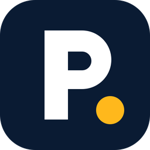
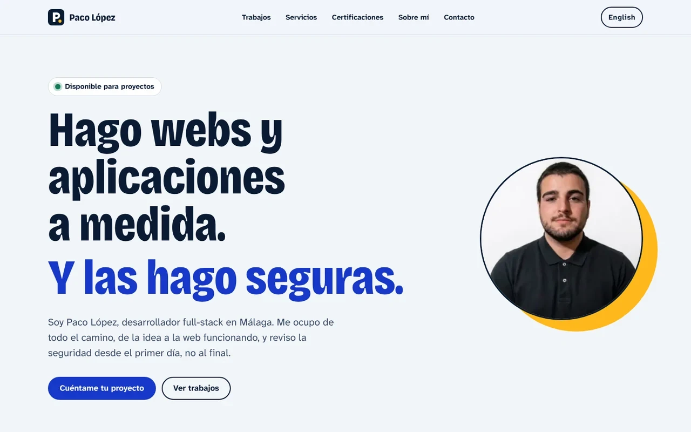
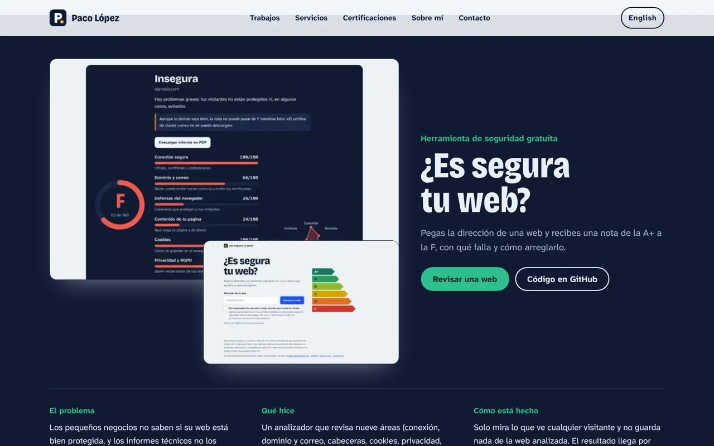
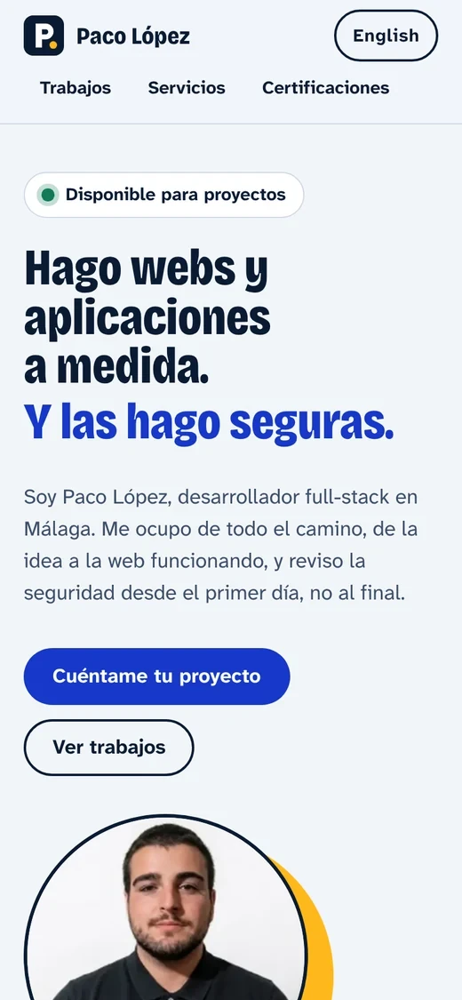

<p align="center">
  
</p>

<h1 align="center">Portfolio de Paco López</h1>

<p align="center">
  <strong>Hago webs y aplicaciones a medida, y las hago seguras.</strong><br>
  Mi portfolio, en español e inglés: tres proyectos terminados, lo que hago y cómo trabajo.
</p>

<p align="center">
  <a href="https://github.com/soypacodev/portfolio/actions/workflows/ci.yml"></a>
  <a href="LICENSE"></a>
  
  
  
  
</p>

<p align="center">
  <a href="https://soypacodev.vercel.app"><strong>Ver el portfolio</strong></a> ·
  <a href="#qué-incluye">Qué incluye</a> ·
  <a href="#cómo-está-hecho">Cómo está hecho</a> ·
  <a href="#seguridad">Seguridad</a> ·
  <a href="#ejecutarlo-en-local">Ejecutarlo en local</a> ·
  <a href="#in-english">English</a>
</p>

<p align="center">
  
</p>

---

## Qué incluye

Una sola página, sin relleno, pensada para que alguien que busca a un desarrollador entienda en un minuto qué hago y pueda comprobarlo.

| Sección | Qué cuenta |
|---|---|
| **Portada** | Quién soy, qué hago y cómo contactarme |
| **Sello de seguridad** | Esta web saca A+ en [¿Es segura tu web?](https://es-segura-tu-web.vercel.app), mi propio analizador, y cualquiera puede comprobarlo |
| **Trabajos** | Tres casos de estudio: el problema, qué hice y cómo está hecho, con capturas reales, cifras comprobables y enlaces a la demo y al código |
| **Servicios** | Webs a medida, seguridad, datos e integraciones, y cómo trabajo: conversación, propuesta, entrega por fases |
| **Certificaciones** | Formación en ciberseguridad, redes y soporte técnico |
| **Contacto** | Correo directo: sin formularios, así que no hay datos que guardar |

Todo está en **español e inglés**. La raíz (`/`) te lleva al idioma de tu navegador y el botón de la cabecera cambia de uno a otro.

<p align="center">
  
</p>

Cada proyecto se presenta con **sus propios colores**, como carteles distintos en la misma pared: la tienda de crochet en crema y azul, el analizador en azul marino y verde, y el limpiador de Windows en verde menta.

<p align="center">
  
</p>

---

## Cómo está hecho

| Pieza | Qué se usa | Por qué |
|---|---|---|
| Aplicación | **Next.js 16** (App Router) y **React 19** | Todo se pinta en el servidor: la web no envía JavaScript propio al navegador, solo el mínimo de Next.js |
| Lenguaje | **TypeScript** en modo estricto | El tipo [`Contenido`](src/content/tipos.ts) obliga a que cada texto exista en español y en inglés: si falta uno, no compila |
| Idiomas | **Rutas con prefijo** (`/es`, `/en`) | Sin librería: el [proxy](src/proxy.ts) elige el idioma por la cabecera `Accept-Language` y cada página declara sus alternativas (`hreflang`) |
| Estilos | **CSS propio** con variables de diseño | Sin framework de estilos: menos peso y control total. Modo claro y oscuro según el sistema |
| Tipografía | Bricolage Grotesque y Atkinson Hyperlegible Next, **servidas desde el propio dominio** | Nada de Google Fonts: ni peticiones externas ni IP compartidas con terceros |
| Imágenes | `next/image` | AVIF o WebP con el tamaño justo para cada pantalla y carga diferida |
| Vista previa | `opengraph-image` generada con `next/og` | Una imagen por idioma, con la misma tipografía que la web |
| Pruebas | **Vitest** | Idiomas, contenido, cabeceras y proxy (ver abajo) |
| Despliegue | **Vercel**, con las funciones en Dublín | La región está fijada en [`vercel.json`](vercel.json) |

Es **una web sin base de datos, sin cookies y sin servicios de terceros**: no hay nada que mantener ni nada que se pueda filtrar.

---

## Seguridad

Una web que presume de seguridad tiene que aguantar que la revisen. Esta lo hace con los mismos criterios que mi analizador:

- **Política de contenido (CSP) con nonce por petición** ([`src/proxy.ts`](src/proxy.ts) y [`src/lib/seguridad/csp.ts`](src/lib/seguridad/csp.ts)): solo se ejecutan los scripts firmados con el nonce de esa respuesta (`'strict-dynamic'`, sin `'unsafe-inline'` ni `'unsafe-eval'` en producción), `frame-ancestors 'none'`, `object-src 'none'`, `base-uri 'self'` y `form-action 'self'`.
- **Cabeceras fijas** en [`next.config.ts`](next.config.ts): HSTS de dos años con `preload`, `X-Content-Type-Options: nosniff`, `Referrer-Policy: strict-origin-when-cross-origin`, `Permissions-Policy` que apaga cámara, micrófono y ubicación, `X-Frame-Options: DENY` y `Cross-Origin-Opener-Policy`. Sin cabecera `X-Powered-By`.
- **Cero terceros.** Ni analítica, ni tipografías externas, ni píxeles, ni iframes. La CSP solo permite cargar recursos del propio dominio.
- **Sin cookies ni formularios.** El correo es un enlace `mailto:`: el mensaje no pasa por la web.
- **Datos estructurados** (`schema.org`) generados en el servidor y con `<` escapado.
- **Contenido revisado por pruebas**: una prueba comprueba que no se cuela ningún teléfono, documento, dirección ni otro correo que no sea el de contacto.

Para avisar de un fallo, escríbeme a [soypacodev@gmail.com](mailto:soypacodev@gmail.com).

---

## Calidad

| Qué | Cómo | Dónde |
|---|---|---|
| Idiomas | Español e inglés con exactamente la misma estructura, los mismos enlaces y las mismas imágenes | [`src/content/contenido.test.ts`](src/content/contenido.test.ts) |
| Contenido | Sin datos privados, con textos alternativos, enlaces `https` e imágenes que existen | ídem |
| Elección de idioma | `Accept-Language` con pesos, orden, `q=0` y basura | [`src/lib/i18n.test.ts`](src/lib/i18n.test.ts) |
| Proxy | Redirecciones, CSP con nonce distinto en cada petición y sin `unsafe-inline` en scripts | [`src/proxy.test.ts`](src/proxy.test.ts) |
| Tipos y estilo | `tsc` estricto y ESLint con las reglas de Next.js, sin avisos | [`eslint.config.mjs`](eslint.config.mjs) |
| Integración continua | Todo lo anterior, `next build` y `npm audit` en cada push y cada PR | [`.github/workflows/ci.yml`](.github/workflows/ci.yml) |

**Accesibilidad.** Revisada con axe-core en 8 anchos (de 320 a 1920 px), en claro y oscuro y en los dos idiomas, sin ningún fallo; sin desbordamiento horizontal; foco visible en todo y enlace para saltar al contenido; zonas pulsables de al menos 24 px; y animaciones que se apagan con `prefers-reduced-motion`.

---

## Estructura

```
src/
├── app/
│   ├── [lang]/              página principal, privacidad, aviso legal, 404 y error (es y en)
│   │   └── opengraph-image  vista previa para redes, una por idioma
│   ├── icon.tsx             favicon (la «P» y el punto de sol)
│   ├── apple-icon.tsx       icono de iOS
│   ├── globals.css          sistema de diseño: colores, tipografía y cada sección
│   ├── robots.ts
│   └── sitemap.ts           con las alternativas por idioma
├── componentes/             una pieza por sección: portada, trabajos, servicios…
├── content/                 los textos: es.ts, en.ts y el tipo que los obliga a ser iguales
├── lib/
│   ├── i18n.ts              idiomas y elección por Accept-Language
│   ├── seguridad/csp.ts     política de seguridad de contenido
│   └── sitio.ts             datos fijos: dirección, correo, enlaces
└── proxy.ts                 idioma y CSP con nonce por petición
public/
├── img/                     capturas de los proyectos
└── paco-lopez.jpg
assets/fuentes/              tipografías para las imágenes de vista previa, con su licencia
docs/                        icono y capturas de este README
```

---

## Ejecutarlo en local

Necesitas **Node.js 22.18 o superior**. No hace falta configurar nada: no hay variables de entorno.

```bash
git clone https://github.com/soypacodev/portfolio.git
cd portfolio
npm install
npm run dev
```

Abre <http://localhost:3000>. Para comprobarlo todo antes de subir cambios:

```bash
npm run verificar   # lint + tipos + pruebas + compilación
```

Para cambiar un texto, edita [`src/content/es.ts`](src/content/es.ts) y [`src/content/en.ts`](src/content/en.ts): TypeScript avisa si falta algo en uno de los dos.

---

## Licencia

Código bajo licencia [MIT](LICENSE). Los textos, las capturas de mis proyectos y la foto son míos: si quieres reutilizarlos, escríbeme.

Las tipografías (Bricolage Grotesque y Atkinson Hyperlegible Next) tienen licencia OFL; las copias para las imágenes de vista previa están en [`assets/fuentes`](assets/fuentes) con su texto.

---

## In English

**My portfolio: I build custom websites and apps, and I build them secure.** Three finished projects (an online shop, a free security analyser and a Windows desktop app), what I do and how I work, in Spanish and English.

- **One page, no database, no cookies, no third parties.** Built with Next.js 16, React 19 and strict TypeScript, deployed on Vercel.
- **Bilingual by construction.** The `Contenido` type forces every text to exist in both languages; a test checks that both versions share the same structure, links and images. `/` redirects to your browser's language.
- **Secure by default.** Per-request nonce CSP with `'strict-dynamic'`, two-year HSTS, no inline scripts, no third-party requests. It scores A+ on my own analyser, [¿Es segura tu web?](https://es-segura-tu-web.vercel.app).
- **Accessible.** axe-core clean at eight widths from 320 to 1920 px, light and dark, in both languages; full keyboard use with visible focus; reduced-motion respected.

```bash
git clone https://github.com/soypacodev/portfolio.git
cd portfolio
npm install
npm run dev        # http://localhost:3000
npm run verificar  # lint + types + tests + build
```

Code under the [MIT licence](LICENSE). Text, project screenshots and the photo are mine: ask before reusing.
